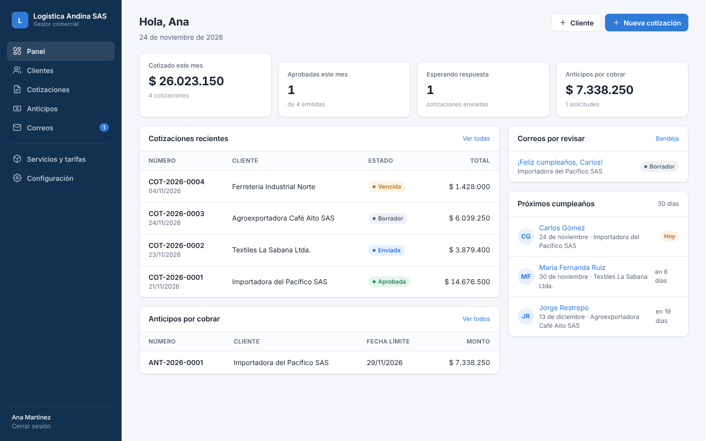

# Gestor Comercial · AMG Logistics

Aplicación web para gestionar clientes, cotizaciones, solicitudes de fondos (anticipos) y correos, con saludos de cumpleaños automáticos. Los documentos siguen los formatos de AMG Logistics SAS.



## Qué incluye

| Módulo | Qué hace |
|---|---|
| **Clientes** | Base de datos con NIT, contacto, correos en copia, teléfono, dirección, notas y fecha de nacimiento (opcional). Se puede buscar, importar y exportar en CSV (Excel). |
| **Servicios y tarifas** | Catálogo precargado con los conceptos de la hoja "Base de Datos" de AMG (agenciamiento, proceso de aduana, liberación, fletes, manejos en puerto, handling, etc.). Cada concepto tiene unidad, tarifa, IVA (servicio propio o pago a terceros) y grupo para la solicitud de fondos. |
| **Cotizaciones** | Formato "Cotización de servicios logísticos": numeración automática (`COT-2026-0001`), ejecutivo, condición de pago, datos del servicio (origen, destino, ruta, modalidad, Incoterm, tipo de carga, contenedor, naviera/aerolínea, tiempo de tránsito, días libres, peso, volumen, piezas), ítems con impuestos y observación, nota de tarifas, condiciones y bloque de aceptación. Estados: borrador, enviada, aprobada, rechazada y vencida. |
| **Solicitud de fondos** | El anticipo con el formato de AMG (`SF-2026-0001`): D.O., aduana, documento de transporte, partida arancelaria, liquidación de tributos (FOB + flete + seguro + otros = CIF × TRM → arancel e IVA) y conceptos agrupados en intermediación aduanera, gastos aerolínea/puerto y otros gastos. Se puede crear desde una cotización. Incluye los datos bancarios y el control de pago. |
| **Correos** | Borradores listos con el PDF adjunto. **Nada se envía sin tu revisión y confirmación.** Guarda el historial por cliente. |
| **Cumpleaños** | Cada día a las 8:00 (hora de Bogotá) prepara el saludo de quien cumple años. Por defecto queda como borrador; el envío automático se activa en Configuración. |
| **Usuarios** | El administrador crea usuarios, asigna el rol (administrador o usuario), restablece contraseñas y desactiva accesos. Cada persona edita sus datos y su contraseña en "Mi cuenta". Su nombre sale como ejecutivo y en la firma de los correos. |
| **Panel** | Lo cotizado en el mes, cotizaciones aprobadas y en espera, anticipos por cobrar, correos pendientes y próximos cumpleaños. |

Ejemplos de documentos: [cotización](ejemplos/cotizacion-ejemplo.pdf) · [solicitud de fondos](ejemplos/solicitud-fondos-ejemplo.pdf)

## Instalación

Requisitos: Python 3.11 o superior. En Linux también hacen falta las librerías de WeasyPrint (`libpango`).

```bash
python -m venv .venv
source .venv/bin/activate        # En Windows: .venv\Scripts\activate
pip install -r requirements.txt
cp .env.example .env             # y completa los valores
python run.py                    # abre http://localhost:5000
```

La primera vez, la app te pide crear tu usuario, que queda como **administrador**. La app ya trae el logo, la dirección, el teléfono, el correo, la cuenta bancaria y las condiciones de AMG. En **Configuración** solo falta completar el NIT. Luego crea los usuarios de tu equipo en **Usuarios**.

Si actualizas desde una versión anterior, la base de datos se ajusta sola al arrancar, sin perder información.

## Configurar el correo corporativo

En el archivo `.env`:

```ini
SMTP_MODO=smtp
SMTP_HOST=mail.tudominio.com
SMTP_PORT=587
SMTP_SEGURIDAD=tls
SMTP_USUARIO=comercial@tudominio.com
SMTP_CLAVE=tu-clave
SMTP_REMITENTE=comercial@tudominio.com
```

Mientras `SMTP_MODO=archivo`, los correos se guardan en `instance/correos_prueba/` y **no le llegan a nadie**. Así puedes probar sin riesgo.

| Proveedor | Servidor | Puerto / seguridad |
|---|---|---|
| Microsoft 365 / Outlook | `smtp.office365.com` | 587 / tls |
| Google Workspace | `smtp.gmail.com` | 587 / tls (usa una "contraseña de aplicación") |
| cPanel / hosting | `mail.tudominio.com` | 465 / ssl o 587 / tls |

## Publicarla en internet (Render)

El repositorio incluye `Dockerfile` y `render.yaml`:

1. En https://render.com, entra con tu cuenta de GitHub.
2. Elige **New → Blueprint**, selecciona `gestor-comercial` y pulsa **Apply**.
3. Al terminar, Render te da un enlace del tipo `https://gestor-comercial-xxxx.onrender.com`.

En el plan gratuito, la app se "duerme" tras 15 minutos sin uso y tarda unos 50 segundos en despertar. Además, **los datos se borran en cada nueva publicación o reinicio**. Sirve para pruebas. Para uso real se necesita un disco persistente (plan Starter, con `DATABASE_URL=sqlite:////var/data/gestor.db`) o una base de datos PostgreSQL.

## Pruebas

```bash
pip install pytest && python -m pytest
```

## Hoja de ruta recomendada

**Fase 2: agilidad comercial**
1. **Seguimiento automático:** un recordatorio (borrador) a los 3 días de enviar una cotización sin respuesta.
2. **Recordatorio de anticipos** antes y después de la fecha límite.
3. **Plantillas de cotización** por tipo de operación, por ejemplo "Importación marítima FCL", para cotizar en un clic.
4. **Envío por WhatsApp** del PDF con un enlace (wa.me).
5. **Varias monedas con TRM** del día para cotizaciones en USD.

**Fase 3: el agente con IA**
1. **Redactar correos** con Claude según el contexto del cliente y el historial.
2. **Cotizar desde un correo:** pegas la solicitud del cliente y el agente arma el borrador de la cotización.
3. **Resumen semanal:** qué cotizaciones seguir, quién no ha pagado y qué clientes no han vuelto a cotizar.
4. **Bandeja de entrada:** leer las respuestas de los clientes y marcar automáticamente las cotizaciones como aprobadas o rechazadas.

**Fase 4: operación y control**
- Usuarios con roles (comercial, financiero), facturación electrónica (DIAN) vía proveedor tecnológico, seguimiento de cada operación (estados del embarque) y reportes de ventas por cliente o servicio.
